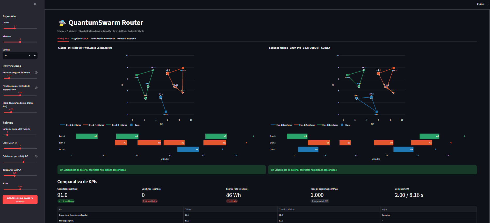

# QuantumSwarm Router

Asignación de misiones y rutas para una flota de drones con batería limitada, ventanas de tiempo y separación espaciotemporal. Compara un VRPTW clásico (OR-Tools) con un pipeline cuántico híbrido (QUBO → Ising → QAOA en qiskit-aer + COBYLA).

## Ejecutar

**Python 3.12 recomendado**
```bash
python -m venv .venv && source .venv/bin/activate   # Windows: .venv\Scripts\activate
pip install -r requirements.txt
streamlit run app.py
```

## Arquitectura

```
app.py                     UI Streamlit, ejecución paralela y aislamiento de errores
core/scenario.py           Drones, misiones, matriz de distancias
core/evaluator.py          Simulador común: tiempos, energía, conflictos, KPIs
core/classical_solver.py   OR-Tools VRPTW multi-depósito (+ greedy de respaldo)
core/qubo_builder.py       QuadraticProgram → QUBO (qiskit-optimization) → Ising
core/quantum_solver.py     QAOA (Aer statevector) + COBYLA + muestreo y decodificación
core/sequencer.py          Orden de visita por dron y reparación de batería
ui/plots.py                Figuras Plotly
```

Flujo híbrido: lotes de misiones → QUBO por lote → QAOA → asignación → secuencia clásica por dron → reparación → evaluación.

## Deficiones

**Límite de tiempo OR-Tools (s)**

Es el tiempo máximo que OR-Tools dedica a buscar mejores rutas. Si el solver llega al límite, devuelve la mejor solución encontrada hasta entonces. Con pocas misiones, OR-Tools suele converger en fracciones de segundo, así que aumentarlo casi nunca mejora el resultado. Sirve sobre todo para controlar la duración de la demo.

**Capas QAOA (p)**

Es el número de repeticiones del circuito cuántico. Cada capa aplica un operador de coste (que codifica el QUBO) y otro de mezcla (que explora soluciones). Con p=1 el circuito es muy poco profundo y la calidad suele ser baja. Con p=2 o 3 QAOA puede concentrar más probabilidad en soluciones buenas, pero el número de parámetros a optimizar crece y el circuito tarda más en simularse. Un valor de 2 es un buen equilibrio para una demo.

**Qubits máx. por sub-QUBO**

Limita el tamaño de cada subproblema que se resuelve con QAOA. Cada lote contiene `⌊qubits / drones⌋` misiones; por ejemplo, con 12 qubits y 3 drones, cada lote tiene 4 misiones. Cada qubit adicional duplica el tamaño del vector de estado que simula Aer, así que el coste crece exponencialmente. Valores mayores dan lotes más grandes, con mejor visión global pero más lentos. Con 16 qubits la simulación puede tardar bastante en un portátil. El valor mínimo es el número de drones, porque cada misión necesita al menos un qubit por dron.

**Iteraciones COBYLA**

Es el presupuesto de evaluaciones del optimizador clásico que ajusta los ángulos γ y β del circuito. En cada evaluación se simula el circuito completo, así que este valor es el principal responsable del tiempo de cómputo cuántico. Si es demasiado bajo, el optimizador puede parar antes de converger; si es demasiado alto, gasta tiempo sin mejorar mucho el resultado. Con 100 a 150 suele bastar para sub-QUBOs pequeños.

**Shots**

Es el número de mediciones que se toman del circuito final. Simulan lo que ocurriría en hardware real, donde no se puede leer el estado completo sino solo muestras. La app elige la mejor muestra factible, es decir, una asignación que cumple que cada misión tiene exactamente un dron. Shots no afecta al optimizador, solo a la lectura final. Con sub-QUBOs pequeños, 1024 o 2048 bastan; más shots solo aportan precisión si el circuito tiene muchas soluciones cercanas en calidad.

### Valores sugeridos

| Campo | Demo rápida | Equilibrado (recomendado) | Máxima calidad |
| --- | --- | --- | --- |
| Límite OR-Tools (s) | 1 | 2 | 5 |
| Capas QAOA (p) | 1 | 2 | 3 |
| Qubits máx. por sub-QUBO | 9 a 12 | 12 | 14 a 16 |
| Iteraciones COBYLA | 50 | 120 | 200 o más |
| Shots | 512 | 2048 | 4096 o más |


## Sistema Funcionando
